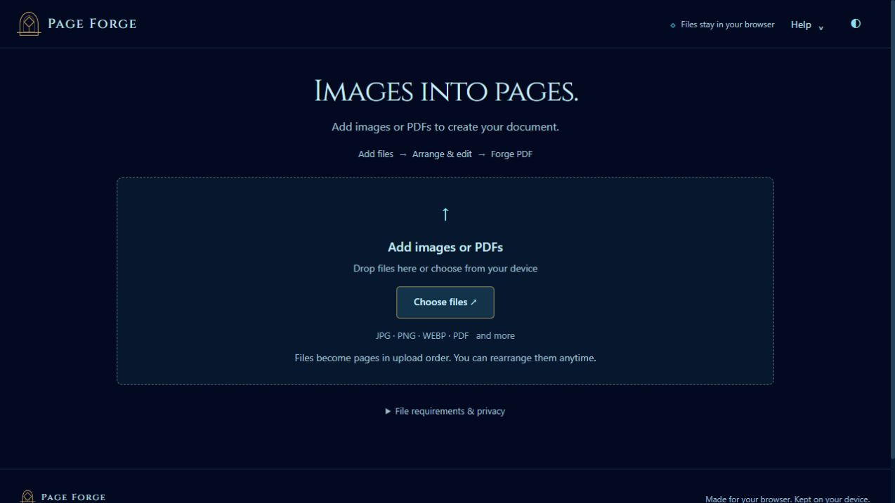
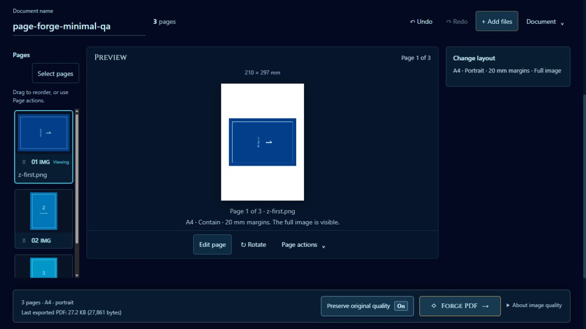
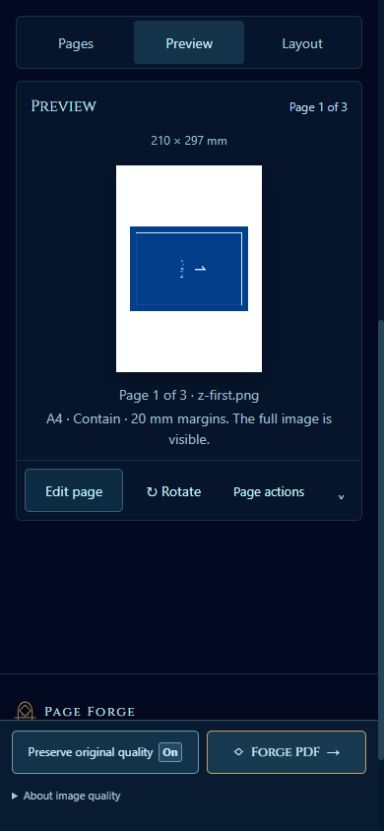

# Page Forge — minimal UI implementation

Implemented October 10, 2026. The user requested a simple, minimal interface across the webpage while retaining the existing theme, features, and capabilities, then authorized implementation.

## Result

The interface now prioritizes adding files, working with the current page, and forging the document. The ocean navy/blue palette, sparse antique gold, Cinzel branding, dark theme control, and paper preview remain. Supporting controls use plain labels and quiet surfaces.

- **Start screen:** a short heading and Add → Arrange & edit → Forge guide lead into one image/PDF intake. Requirements and privacy are disclosed on request. Help groups instructions, keyboard shortcuts, requirements, and About.
- **Document toolbar:** document name, page count, Undo, Redo, Add files, and a Document menu replace competing toolbars. Sort, reverse, clear, and freeing undo history remain in the menu. Undo remains reachable after removing the last page.
- **Pages:** choosing a thumbnail previews that page. Select pages reveals checkboxes and contextual batch actions; Done clears the batch selection without changing the active page. Batch rotation never silently falls back to every page, and batch removal is one undoable operation.
- **Preview:** Edit page and Rotate are visible. Page actions contains duplicate, Move earlier/later, full-size preview, and Remove this page. Current-page actions stay independent of checked batch targets. Drag reordering remains optional.
- **Layout:** Change layout starts collapsed with a summary of the chosen settings. Paper, margins, placement, compression, and PDF preservation remain. DPI appears for Fit to image or Photo print size; overflow appears for Photo print size. Hiding irrelevant controls retains their chosen values. Native-only preserved PDF documents hide image-only layout controls.
- **Phones:** Pages, Preview, and Layout show one panel at a time. Tabs expose the selected view to assistive technology, support arrow/Home/End navigation, and make hidden panels inert. Explicit view changes align the tab strip and panel in the viewport. Continue editing returns to Pages on phones and the document toolbar on desktop.
- **Editor:** Rotate & flip, Crop, Resize, and Adjust group the existing tools. Precision angle, crop coordinates, resize shortcuts, additional adjustments, bulk adjustments, and Revert use named disclosures. Update preview prepares the tool change; the persistent Cancel / Save this page footer makes the commit step clear. Bulk adjustment scope still excludes crop and resize.
- **Export:** Preserve original quality stays beside Forge PDF. Its explanation is available on demand. Complete results say Your PDF is ready and offer Download PDF, Continue editing, and New document. Actual-byte, skipped-page, failure, and stale-download reporting remain.

The import queue, working-file limits, automatic large-image fitting, original-byte handling, lossless export, native PDF processing, and retained-download budget continue to use the existing engines. This pass does not change the accepted formats or processing limits.

## Implementation

`index.html` defines the simplified controls and disclosures. `css/minimal-ui.css` and `css/minimal-editor.css` apply the minimal presentation after the existing theme styles. `js/forge-ui.js` owns view and selection state, menu behavior, layout summaries, and focus recovery. `js/app.js` connects the existing page/history engine to these controls. `js/editor.js` groups tabs and restores focus to a visible workspace control after closing.

Menu-triggered Help and full-size preview return focus to a persistent menu summary, rather than a now-hidden menu item. Editor closure uses a visible trigger or the active workspace panel. Page navigation keeps focus out of hidden phone panels. Resize and state refresh preserve the user's disclosure choice.

## Verification

The complete command `node --experimental-vm-modules --test tests/*.test.cjs` passed **605/605 tests**, with no failures, cancellations, or skipped tests. The final log is a development artifact at `tmp/minimal-ui-final-tests.log`.

The new `tests/minimal-ui.test.cjs` exercises the real document/history engine with a mocked DOM boundary: batch selection/removal/rotation, current-page removal scope, view switches without export-state changes, keyboard tab navigation, focused mobile scrolling, menu/modal focus recovery, retained layout choices, native-PDF control visibility, and conditional print controls. Editor and existing UI/export tests cover the reorganized tool IDs and final labels.

`node scripts/dependency-check.cjs` passed for **222 local dependency files / 7,973,623 bytes**. No vendor libraries or local fonts changed.

Local browser verification covered:

- Three synthetic PNGs imported in their supplied nonalphabetical order: `z-first.png`, `a-second.png`, `m-third.png`.
- Selection and bulk rotation of pages 1 and 3 only; Done cleared batch checks.
- Desktop workspace fit and the phone Pages, Preview, and Layout panels at an emulated 390 × 844 viewport, without horizontal overflow.
- Conditional DPI/overflow controls, editor tabs/disclosures/footer, and save of a rotated page.
- Full-size preview close returning visible focus; the latest start screen's Help dialog returned focus to its closed Help summary.
- A browser-generated `page-forge-minimal-qa.pdf` containing **3 pages and 27,861 bytes**. Independent pypdf inspection confirmed every page is **210 × 297 mm**. The UI reported the same actual bytes and 3 of 3 pages exported.

The mobile scroll-positioning change is also covered by the automated navigation regression. Screenshots show the inspected workspace at a useful scroll position. Viewport emulation is not physical-device, screen-reader, or cross-browser acceptance. Historical processing verification remains in the earlier implementation records.

## Screenshots

## Handoff

Serve the complete application folder using `python scripts/serve-preview.py`; it supplies the required module MIME types. The current review preview uses loopback port 8767. Hosting has not been configured or published by this pass. Development files in `tmp/` are not deployment assets.

This is a UI follow-up. It does not complete unrelated historical audit items: progress remains **24/57**, with native-PDF advanced-feature preservation issue 16 partial. Refer to [Memory.md](../Memory.md), the [canonical design](PAGE-FORGE-DESIGN.md), and the [large-image record](LARGE-IMAGE-IMPORT-2026-10-09.md) for persistent project constraints.
