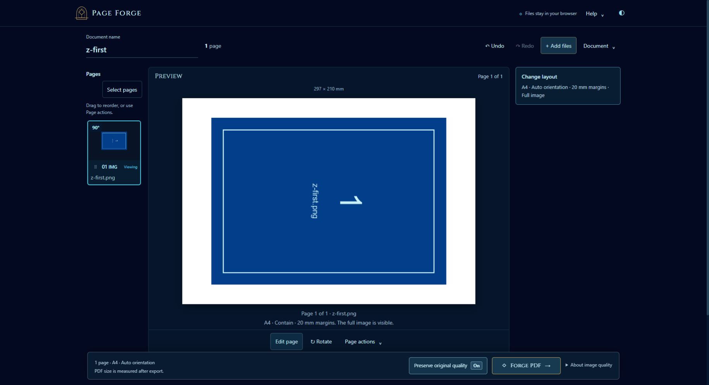
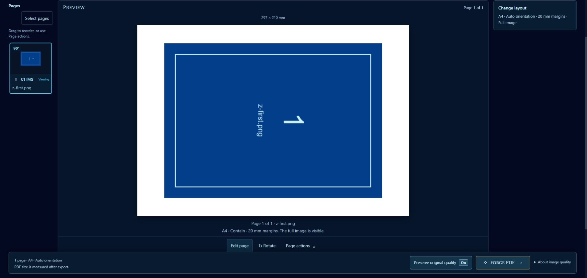

# Preview fit — October 11, 2026

The user requested that the central page preview fill its allocated area for easier viewing. Fixed width caps kept landscape pages small even when the preview stage had ample space.

Removed the base 390-pixel width cap, desktop 440-pixel maximum, and tablet 340-pixel maximum in `css/minimal-ui.css`. Desktop and phone retain the existing ratio-based fit within the stage's usable width and height. Tablet paper uses the available width with natural proportional height; tall tablet pages remain accessible by scrolling. Preview painting, PDF layout, export dimensions, margins, and image placement are unchanged.

Verification:

- **1836 × 1000 desktop:** landscape A4 paper approximately **758 × 536 CSS pixels**, using all 536 pixels of usable stage height. Its previous desktop width cap was 440 pixels. Portrait paper approximately 379 × 536 pixels also fits the available height.
- **820 × 1000 tablet:** landscape paper approximately 561 × 397 pixels; portrait approximately 561 × 794 pixels. Both use all available stage width and remain within its naturally sized height.
- **390 × 844 phone:** landscape approximately 297 × 210 pixels; portrait approximately 148 × 210 pixels. Existing height-bounded phone fitting remains intact.
- No horizontal document overflow at these inspected viewports. Normal browser sizing restored after emulation.
- `node --experimental-vm-modules --test tests/forge-preview.test.cjs tests/pdf-layout.test.cjs`: **46/46 tests passed**. No additional tests were added for this CSS-only adjustment.

Checks use one imported synthetic PNG and the application's rotation/auto-orientation controls. Browser viewport emulation is not physical-device acceptance.

## Full-width desktop follow-up

The user subsequently requested using the empty left and right space at 100% browser zoom. Desktop documents now remove the shell/footer's 1440-pixel maximum width, align the header and fixed export dock to 28-pixel gutters, and retain compact page/layout sidebars. Empty-state content widths and tablet/phone rules are retained.

Width alone would not enlarge a height-limited page, so the desktop stage now uses `clamp(300px, calc(100dvh - 260px), 900px)`. Paper still fits that stage proportionally. The taller workspace can require vertical scrolling from the document toolbar; page actions remain reachable and the export dock remains fixed.

Browser measurements with a synthetic imported PNG and auto-orientation:

| Viewport | Workspace width | Landscape paper | Portrait paper |
| --- | --- | --- | --- |
| 1920 × 912 | 1858 px | 888 × 628 px | 444 × 628 px |
| 1280 × 720 | 1218 px | 617 × 436 px | — |

At the larger viewport, side gutters dropped from approximately 265 to 28 pixels. The old stage sizing would produce a landscape page approximately 634 × 448 pixels there; the new preview is about 40% wider. No horizontal overflow was observed. The 390 × 844 phone check retained its approximately 148 × 210-pixel portrait page inside the existing 234-pixel stage. Normal viewport sizing was restored after testing.

The focused preview/layout command again passed **46/46 tests**, recorded in `tmp/full-width-preview-tests.log`. This follow-up changes only `css/minimal-ui.css`; PDF rendering and output geometry remain unchanged.

