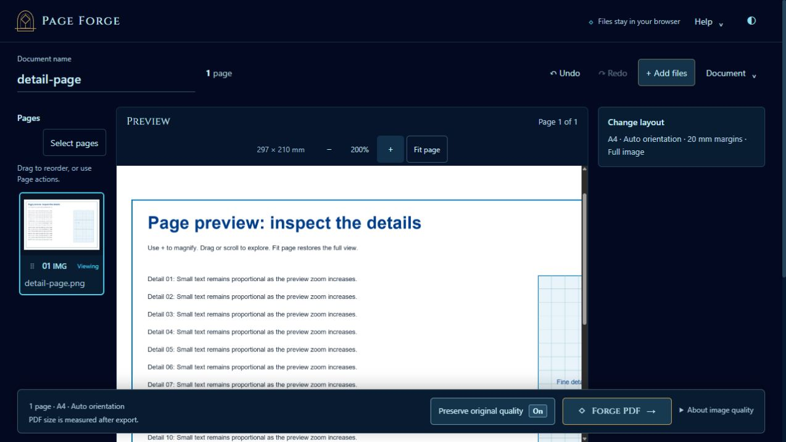
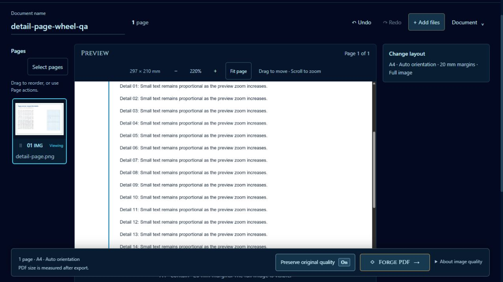

# Preview zoom — October 11, 2026

The user requested a way to zoom into the central page preview to inspect image details. The preview now has compact **−**, percentage, **+**, and **Fit page** controls, retaining the existing theme and proportional whole-page fit.

## Behavior

- Button steps are 100%, 125%, 150%, 200%, 300%, and 400%. Percentages are relative to the fitted view, rather than original image pixels. Fit page restores 100% and clears both scroll axes.
- Enlarged paper stays inside a scrollable stage. Mouse/pen dragging and native touch scrolling pan. Ordinary vertical wheel-up zooms in and wheel-down zooms out while enlarged; at 100%, the wheel scrolls the webpage. With the stage focused, arrows pan by 64 CSS pixels, plus/minus zoom, and zero or Escape restores Fit. Handled keys stop propagation so panning does not trigger document-page navigation.
- Ctrl-wheel also zooms within the same 100–400% range and can explicitly enter zoom from Fit. Shift/Alt/Meta, zero, and horizontal-dominant wheel gestures remain native. Native touch pinch zoom is not implemented by this feature.
- Scaling keeps the page point at the viewport center in view. Selecting a different page, changing preview content/layout, or resizing the window returns to Fit so outdated dimensions cannot leave the page stranded.
- The existing canvas stays visible while a sharper rendering of the same page is prepared. A different page hides previous pixels while loading. Request/key guards reject stale success and failure callbacks, and source leases are released in every completion path.
- Preview resolution increases with zoom from a 1,200-pixel long side, capped at 2,400 pixels. This is a bounded viewing canvas; document/history/export settings and physical page geometry are unchanged. Preserved PDF pages still use their existing import raster, so zoom cannot recover detail absent from that raster or a reduced working image.

Implementation is in `js/forge-preview.js`, `index.html`, and `css/minimal-ui.css`. The existing `PageForgePreview.refresh()` and `.clear()` API additionally exposes `.zoom(number)`, `.zoomIn()`, `.zoomOut()`, and `.fit()`. Zoom is transient and is not saved as document state.

## Verification

`node --experimental-vm-modules --test tests/*.test.cjs` passed **615/615 tests**, with no failures or skips. Full log: `tmp/preview-zoom/full-tests.log`. The focused preview suite passed **23/23**, including 10 new meaningful regressions for canvas bounds, matching export geometry/filters, document/history invariance, native PDF page dimensions, page/layout reset, stale decode races, keyboard propagation, pointer cancellation/capture release, native touch/wheel handling, Ctrl-wheel, resize, and clear/failure cleanup. The Fit-during-decode regression exposed and fixed an `aria-busy` state left by a cached rendering return. `node --check js/forge-preview.js` also passed.

Actual local-browser checks used a synthetic 2,400 × 1,600 PNG at the default **1280 × 720** viewport:

- Fitted landscape A4 paper was approximately **617 × 436 CSS pixels**. At 200%, it became approximately **1,233 × 872**, with internal horizontal and vertical scrolling and a **2,400 × 1,697** canvas.
- At 400%, paper was approximately **2,467 × 1,744** and the plus button disabled; the canvas remained capped at the same dimensions.
- Dragging changed both scroll axes and released the grabbing state. ArrowRight moved the horizontal position by 64 pixels. Fit page returned to 100%, removed the inline enlarged width, cleared both axes, and restored the 1,200-pixel canvas.
- The document had no horizontal overflow, and captured browser warning/error logs were empty.

The browser tool's attempted viewport overrides did not change the actual viewport, including on a fresh tab. These checks therefore establish the stated desktop behavior only. Narrow toolbar wrapping, bounded phone stages, and a definite tablet height while zoomed were reviewed in source; fresh phone/tablet rendering, physical touch gestures, screen-reader behavior, and all-browser acceptance are not claimed. Temporary overrides were reset.

No PDF export code or source intake limits changed. The historical audit remains **24/57**, with issue 16 partial. No publishing occurred.

## Wheel and text-caret follow-up

The user requested wheel zoom after pressing plus, with ordinary webpage scrolling restored at 100%. Normal vertical wheel events now multiply or divide the current zoom by 1.1 while enlarged. The event that reaches Fit finishes the reset without also scrolling; subsequent events use normal page scrolling. At Fit, wheel-up leaves the view at 100% instead of re-entering zoom. Whole-percent normalization ensures the displayed 100% always matches the Fit state. A zoom-only **Drag to move · Scroll to zoom** hint explains the available controls. Missing, loading, or stale selections do not consume wheel scrolling; zoom during a sharper render of the same page remains responsive.

The same follow-up addresses the reported blinking typing marker after clicking ordinary interface text. Static UI text now inherits `caret-color: transparent`; inputs, textareas, and editable hosts restore `auto`. This keeps text selection and keyboard focus available. Current Blink resolves caret color from the navigation anchor without an editable-only guard, while its caret-browsing logic allows noneditable anchors. This supports the scoped color fix for Chromium; other browser navigation-caret rendering remains outside this verification. See [Chromium caret color resolution](https://github.com/chromium/chromium/blob/main/third_party/blink/renderer/core/editing/caret_display_item_client.cc#L201-L205) and [caret browsing visibility](https://github.com/chromium/chromium/blob/main/third_party/blink/renderer/core/editing/frame_caret.cc#L303-L329).

Latest verification: **617/617 full tests**, **25/25 preview tests**, and **101/101 combined focused preview/UI/document/drag tests** passed, with zero failures/skips. The full log is `tmp/preview-zoom/wheel-full-tests.log`. Two additional preview tests and the expanded wheel-cycle test cover return-to-Fit scrolling, gesture exclusions, whole-percent boundary agreement, missing/loading/stale pages, and successive wheel changes during pending decoding.

Actual **1280 × 720** browser checks with the synthetic image verified:

- Plus entered 125%; ordinary wheel-up changed it to 138% without changing document scroll position; wheel-down returned to 125%, then subsequent downward events reached 100%.
- Fit cleared both internal scroll axes, removed the enlarged class, and hid the interaction hint. The next ordinary wheel moved document scrollTop from **0 to 72**, with zoom still 100%. An ordinary upward wheel at Fit later returned page scrollTop to 0 without entering zoom.
- Plus/buttons and ordinary wheel-up subsequently reached 220%, with the visible interaction hint. Drag/arrow navigation remained available.
- Clicking ordinary headings showed transparent computed caret color; Document name retained a visible computed caret and accepted typed characters. Text selection remained `auto`. Clicking the initial hero was also checked before and after F7 input, without a visible text caret; the in-app browser does not establish every external browser's setting or rendering behavior.
- Captured browser warning/error logs were empty. No new responsive or physical-touch acceptance is claimed.

